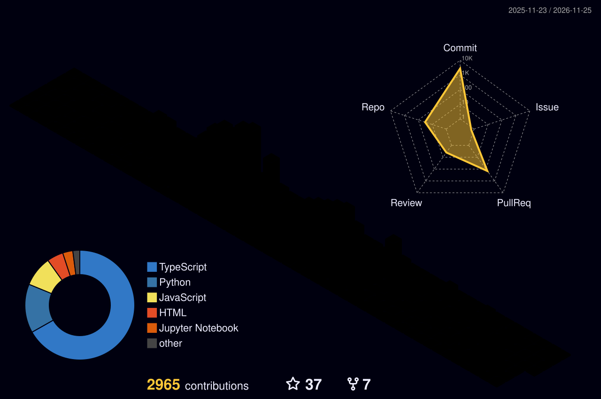

<div align="center">


<br/>

[](https://www.linkedin.com/in/itinerant018)
[](https://github.com/Itinerant18)
[](mailto:itinerant018@gmail.com)
[](https://maps.google.com/?q=Kolkata)

<br/>

[](https://github.com/Itinerant18)
[](https://github.com/Itinerant18?tab=followers)
[](https://github.com/Itinerant18)
[](https://github.com/Itinerant18?tab=repositories)

</div>


##  About Me

<table>
<tr>
<td valign="top" width="58%">

```yaml
name: Aniket Karmakar
role: Junior Executive Engineer — R&D
company: Security Engineers Pvt. Ltd. (SEPLe)
base: Kolkata, India 🇮🇳

focus_areas:
  ▸ High-throughput distributed backends (Go, Kafka, Redis H3)
  ▸ Autonomous multi-agent AI & custom MCP servers
  ▸ Enterprise RAG pipelines (RAPTOR, HyDE, pgvector)
  ▸ Industrial IoT gateways, telemetry & device provisioning
  ▸ Cross-platform full-stack systems (Next.js, Flutter, Cloudflare)

currently_exploring:
  ▸ Multi-Agent orchestration & tool-use workflows
  ▸ Triton ML model serving & graph-based routing
  ▸ Edge computing with Cloudflare Durable Objects
```

</td>
<td valign="top" width="42%" align="center">


</td>
</tr>
</table>


##  Featured Engineering Projects

<table>
<tr>
<td width="50%" valign="top">
  <div align="left">
    <h3>🚗 <a href="https://github.com/Itinerant18/Vahnly">Vahnly</a></h3>
    <p><b>Real-Time Driver-Dispatch Platform</b></p>
    <p>High-throughput Go backend ingesting driver GPS streams over gRPC, indexing availability in Redis H3 spatial cells, with Hungarian/Greedy matching & Triton ML ETA correction.</p>
    
    
    
    
    
  </div>
</td>
<td width="50%" valign="top">
  <div align="left">
    <h3>🤖 <a href="https://github.com/Itinerant18/Seple-Tender-Agent">SEPLE Tender Agent</a></h3>
    <p><b>Autonomous Procurement Intelligence</b></p>
    <p>Decision-support system with a custom Model Context Protocol (MCP) server bridge, Playwright scrapers, and LLM reasoning matching complex tender specifications.</p>
    
    
    
    
    
  </div>
</td>
</tr>
<tr>
<td width="50%" valign="top">
  <div align="left">
    <h3>🧠 <a href="https://github.com/Itinerant18/Swacth360_bot">Dexter Tech Support AI</a></h3>
    <p><b>Multilingual Enterprise RAG Assistant</b></p>
    <p>Industrial IoT assistant with a 21-node RAG pipeline, RAPTOR hierarchical cluster summarization, HyDE embeddings, and two-tier Redis + pgvector caching.</p>
    
    
    
    
    
  </div>
</td>
<td width="50%" valign="top">
  <div align="left">
    <h3>🏠 <a href="https://github.com/Itinerant18/Urban-assist">Urban Assist</a></h3>
    <p><b>UK Home Services Marketplace Monorepo</b></p>
    <p>pnpm monorepo powering 3 Next.js 14 web apps (customer, provider, admin) with typed shared packages, Supabase RLS, and Stripe payments.</p>
    
    
    
    
  </div>
</td>
</tr>
<tr>
<td width="50%" valign="top">
  <div align="left">
    <h3>⚡ <a href="https://github.com/Itinerant18/Tic-tac-toe">TicTac Match</a></h3>
    <p><b>Real-Time Edge Matchmaking & Chat</b></p>
    <p>Mobile-first social gaming platform built on Cloudflare Workers, Durable Objects (MatchmakerDO, RoomDO), and Cloudflare D1 serverless SQL.</p>
    
    
    
    
  </div>
</td>
<td width="50%" valign="top">
  <div align="left">
    <h3>🛍️ <a href="https://github.com/Itinerant18/Serendipity">Serendipity</a></h3>
    <p><b>Multi-Platform E-Commerce Ecosystem</b></p>
    <p>Full-stack marketplace across Web & Expo Mobile with dual-database Supabase architecture, Redis caching, and real-time Socket.IO event FSM.</p>
    
    
    
    
    
  </div>
</td>
</tr>
<tr>
<td width="50%" valign="top">
  <div align="left">
    <h3>📡 <a href="https://github.com/Itinerant18/SWatch360">SWatch360</a></h3>
    <p><b>ThingsBoard Industrial IoT Mobile Client</b></p>
    <p>Flutter app with Clean Architecture & BLoC, on-device ESP32 BLE / SoftAP provisioning, and bidirectional JS-bridge ThingsBoard dashboard WebView.</p>
    
    
    
    
  </div>
</td>
<td width="50%" valign="top">
  <div align="left">
    <h3>📊 <a href="https://github.com/Itinerant18/Data_scrapping_thgingsboard_ml-intern">Bank Outage Scorer</a></h3>
    <p><b>Predictive Infrastructure Analytics</b></p>
    <p>24-hour predictive power outage warning & diagnostic ticket generation for 135 bank gateways over ThingsBoard with calibrated LightGBM model.</p>
    
    
    
    
  </div>
</td>
</tr>
<tr>
<td width="50%" valign="top">
  <div align="left">
    <h3>🎯 <a href="https://github.com/Itinerant18/pookies-ai-zone">Pookies AI Zone</a></h3>
    <p><b>Curated AI Tools Directory & Comparison</b></p>
    <p>Clay/neumorphic Expo mobile app with Convex DB and automated daily scraping pipeline refreshing 320+ AI tools.</p>
    
    
    
    
  </div>
</td>
<td width="50%" valign="top">
  <div align="left">
    <h3>💰 <a href="https://github.com/Itinerant18/Financial-Advisor">FinanceAI Advisor</a></h3>
    <p><b>Full-Stack AI Financial Advisor</b></p>
    <p>Full-stack personal finance advisory platform with interactive KPI monitoring and customized GPT-3.5 prompt-engineered controller.</p>
    
    
    
    
  </div>
</td>
</tr>
</table>


##  Tech Stack

<div align="center">

### 🔤 Languages
[](https://skillicons.dev)

### 🖥️ Frontend, Mobile & Edge
[](https://skillicons.dev)

### ⚙️ Backend & Distributed Systems
[](https://skillicons.dev)

### 🗄️ Databases & Vector Stores
[](https://skillicons.dev)
<br/>


### 🤖 AI · Multi-Agent · RAG


### 📡 Industrial IoT & Hardware
[](https://skillicons.dev)


### ☁️ DevOps & Cloud
[](https://skillicons.dev)

</div>


##  Architecture Mastery

<div align="center">

### ✅ Battle-Tested


### 🔥 Currently Learning


</div>


##  Currently Building

<div align="center">


| Domain | Systems / Modules | Status |
| :---: | :--- | :---: |
| 🤖 **AI & Agents** | SEPLE Tender Agent (MCP Tools + Scrapers) · Sarvam-M | 🟡 Active |
| 🚗 **Dispatch Core** | Vahnly (Go gRPC · Kafka · Redis H3 · Triton ETA) | 🟡 Active |
| 📚 **Enterprise RAG** | Dexter Support AI (RAPTOR · 2-Tier Redis/pgvector) | ✅ Done |
| ☁️ **Edge & Serverless** | TicTac Match (Cloudflare DO + Workers + D1) | ✅ Done |
| 📱 **Mobile Clients** | SWatch360 (Flutter BLE) · Urban Assist (Next.js 14) | 🟡 Active |
| 📊 **Industrial IoT** | ThingsBoard Telemetry Ingestion · MQTT · ESP32 | ✅ Done |

<br/>


</div>


##  GitHub Analytics

<div align="center">


<br/><br/>


<br/>


</div>


##  3D Contribution Skyline

<div align="center">
  <picture>
    <source media="(prefers-color-scheme: dark)" srcset="profile-3d-contrib/profile-night-rainbow.svg" />
    <source media="(prefers-color-scheme: light)" srcset="profile-3d-contrib/profile-green-animate.svg" />
    
  </picture>
</div>


##  Contribution Snake

<div align="center">
  <picture>
    <source media="(prefers-color-scheme: dark)" srcset="https://raw.githubusercontent.com/Itinerant18/Itinerant18/output/github-contribution-grid-snake-dark.svg" />
    <source media="(prefers-color-scheme: light)" srcset="https://raw.githubusercontent.com/Itinerant18/Itinerant18/output/github-contribution-grid-snake.svg" />
    
  </picture>
</div>


##  Dev Character Sheet

<div align="center">

| Attribute | Character Stat |
| :--- | :--- |
| 🏷️ **Name** | Aniket Karmakar |
| ⚔️ **Class** | Systems Architect & Full-Stack Engineer |
| 🏢 **Guild** | Security Engineers Pvt. Ltd. (SEPLe) — R&D |
| 🗺️ **Server** | Kolkata, India 🇮🇳 |
| 🛡️ **Primary Weapons** | TypeScript · Go · Python · SQL · Flutter |
| 🔮 **Magic Specialization** | Multi-Agent AI · MCP Tooling · RAPTOR RAG Pipelines |
| ⚡ **Active Quest** | Autonomous Tender Discovery & Real-Time Telemetry Dispatch |
| 🎯 **Next Boss Fight** | Distributed Consensus · High-Scale K8s Event Sinks |

</div>


## 🤝 Let's Connect

<div align="center">

[](https://www.linkedin.com/in/itinerant018)
[](https://github.com/Itinerant18)
[](mailto:itinerant018@gmail.com)

<br/>


<br/>


</div>